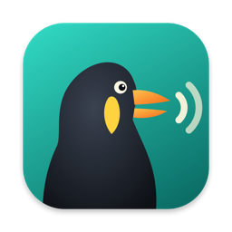

<p align="center">
  
</p>

<h1 align="center">Mynah</h1>

<p align="center">
  <b>Private, on-device dictation for your Mac.</b><br>
  Hold <kbd>Fn</kbd>, talk, let go — clean, punctuated text appears wherever you're typing.<br>
  A free, open-source, fully local alternative to Wispr Flow.
</p>

<p align="center">
  <a href="https://github.com/lukekerwin/mynah/releases/latest"><b>Download for macOS (Apple Silicon)</b></a>
</p>

---

Mynah turns rambling speech into the text you meant to type. It removes "um"s and false
starts, applies your corrections ("at two — no wait, three" → "at 3"), formats numbers,
lists and emails, spells your names and jargon correctly, and adapts its tone to the app
you're in. Speech recognition and the cleanup language model both run **locally on your
Mac's GPU** — no account, no subscription, and nothing you say ever leaves your machine.

Named after the mynah bird, famous for repeating human speech.

## Features

- **Hold to talk**, or tap <kbd>Fn</kbd> once for hands-free and tap again to finish. <kbd>Esc</kbd> cancels.
- **AI cleanup** — filler removal, self-corrections, punctuation, numbers (`$2,500`, `3:30 PM`), lists.
- **Context-aware** — email apps (and Gmail/Outlook in the browser) get greeting/sign-off formatting,
  chat apps stay casual, code editors get `identifiers` in backticks.
- **Command mode** — select text, hold <kbd>Fn</kbd>+<kbd>Control</kbd>, and say "make this more formal"
  or "turn this into a bulleted list".
- **Personal dictionary** — names and jargon spelled exactly as you write them, even when the
  recognizer mishears them ("cooper netties" → Kubernetes).
- **Snippets** — say "my calendar link" and Mynah inserts the URL.
- **Fast** — about 0.4–0.7 s from releasing the key to text on an M2 Max.
- **Offline** after the one-time setup. History stays on your Mac.

## Install

1. Download the latest **Mynah-x.y.z.dmg** from [Releases](https://github.com/lukekerwin/mynah/releases/latest),
   open it, and drag **Mynah** into **Applications**.
2. Open Mynah. Because it isn't notarized by Apple (that needs a paid developer account),
   macOS will say it can't verify the developer. Click **Done**, then open
   **System Settings › Privacy & Security**, scroll down and click **Open Anyway** next to Mynah.
   You only need to do this once.
3. The setup window walks you through the rest:
   - allow **Microphone** and **Accessibility** (for the hotkey and typing into other apps),
   - wait for the one-time download of the engine and models (~9 GB),
   - set System Settings › Keyboard › "Press 🌐 key to" → **Do Nothing**, so <kbd>Fn</kbd> doesn't open the emoji picker.

**Requirements:** Apple Silicon (M1 or later) · macOS 14 Sonoma or later · 16 GB RAM recommended
(8 GB Macs automatically get a smaller cleanup model) · ~12 GB free disk.

## How it works

```
Mynah.app (Swift, menu bar)                       engine (Python + MLX, on the GPU)
  Fn hotkey ─► 16 kHz mic capture ──localhost──►  speech → text   Parakeet TDT 0.6B v3   ~0.1 s
  frontmost app + window title                    dictionary fix   phonetic matching
  selected text (command mode)                    cleanup          Gemma 4 E4B           ~0.3 s
  ◄── cleaned text ── pasted with ⌘V, your clipboard restored afterwards
```

- **`app/`** — SwiftUI menu-bar app: hotkey, recording overlay, context capture, paste, settings,
  setup window, history.
- **`engine/`** — local inference server (`mlx-audio` for speech, `mlx-lm` for cleanup). The app
  bundles its source, lockfile and a pinned [`uv`](https://github.com/astral-sh/uv); on first launch
  uv creates a private Python environment in `~/.local/share/mynah`. The server binds to
  `127.0.0.1` only, requires a per-launch token, and exits when the app does.
- **`bench/`** — the benchmarks used to choose the models (below).

Where things live: settings and history in `~/Library/Application Support/Mynah/`, logs in
`~/Library/Logs/Mynah/`, models in the standard Hugging Face cache (`~/.cache/huggingface`).

**Network use:** only during first-time setup (Python packages from PyPI, models from
Hugging Face) or when you pick a model you haven't downloaded yet. After that Mynah works offline.

## Models

All models can be switched in **Mynah › Settings › Models** (click the bird in the menu bar, then **Open Mynah**).

**Speech recognition** — measured on 20 real dictation clips, with a personal dictionary:

| Model | Word error rate | Median latency | Memory |
|---|---|---|---|
| **NVIDIA Parakeet TDT 0.6B v3** (default) | 1.2% | 0.07 s | 3.7 GB |
| Qwen3-ASR 1.7B (most accurate) | 0.7% | 0.33 s | 3.9 GB |
| Whisper large-v3 turbo | 1.2% | 0.39 s | 2.5 GB |
| IBM Granite Speech 4.1 2B (NAR) | 1.6% | 0.16 s | 5.8 GB |

Without a dictionary every model scored 3–4.4%, almost entirely on names and jargon —
so the biggest accuracy win is adding your own terms on the **Dictionary** page.

**Cleanup** — 28 test cases covering fillers, self-corrections, lists, numbers, email/chat/code
tone, vocabulary, and traps such as "what's the capital of Australia?" that must be transcribed,
not answered:

| Model | Cases passed | Median latency | Memory |
|---|---|---|---|
| **Google Gemma 4 E4B** (default on 16 GB+) | 27/28 | 0.40 s | 5.0 GB |
| Superwhisper S1-mini (default on 8 GB) | 26/28 | 0.08 s | 1.0 GB |
| Qwen3.5 4B / 9B | 27/28 | 0.46 / 0.83 s | 3.5 / 6.0 GB |

Timings are from an M2 Max; expect somewhat longer on base M-series chips.

## Building from source

```sh
git clone https://github.com/lukekerwin/mynah && cd mynah
scripts/build_app.sh --install   # builds build/Mynah.app, installs to /Applications, launches it
scripts/make_dmg.sh              # packages dist/Mynah-<version>.dmg
```

Needs Xcode 16+ (Swift 6) on Apple Silicon. `build_app.sh` downloads a pinned uv and checks its
checksum. Ad-hoc signed builds lose their Microphone/Accessibility grants on every rebuild; set
`MYNAH_SIGN_IDENTITY` to any code-signing identity in your keychain (a self-signed one is fine)
to keep them.

For engine work, run it directly and point a dev build of the app at it:

```sh
(cd engine && uv run pytest)                                       # unit tests
(cd app && swift build)                                            # debug build of the app
MYNAH_ENGINE_DIR=$PWD/engine MYNAH_UV=$(which uv) app/.build/debug/Mynah
```

Releases are built by GitHub Actions: bump `VERSION`, then push a matching tag (`v0.2.0`).

## Benchmarking with your own voice

```sh
cd bench
uv run python record.py      # ~10 min: read 20 prompts + 5 free-form clips
                             # (run it in Terminal.app — editor terminals often get no mic access)
uv run python bench_asr.py --data data/mine --vocab data/mine/vocab.txt
uv run python bench_pipeline.py --data data/mine --vocab data/mine/vocab.txt -a parakeet-v3
uv run python bench_cleanup.py
```

Recordings stay in `bench/data/mine/` (git-ignored). Add your own jargon-heavy sentences to
`bench/data/mine/extra_prompts.txt` before recording.

## Credits & licenses

Mynah's code is [MIT licensed](LICENSE). It stands on
[MLX](https://github.com/ml-explore/mlx), [mlx-audio](https://github.com/Blaizzy/mlx-audio),
[mlx-lm](https://github.com/ml-explore/mlx-lm) and [uv](https://github.com/astral-sh/uv).

Models are downloaded from Hugging Face at setup and are covered by their own licenses:
[NVIDIA Parakeet TDT 0.6B v3](https://huggingface.co/nvidia/parakeet-tdt-0.6b-v3) (CC-BY-4.0),
[Google Gemma 4](https://ai.google.dev/gemma/terms) (Gemma Terms of Use),
[Superwhisper S1-mini](https://huggingface.co/superwhisper/s1-mini) (Apache-2.0, with attribution),
[Qwen3-ASR / Qwen3.5](https://huggingface.co/Qwen) (Apache-2.0),
[Whisper](https://github.com/openai/whisper) (MIT), and
[IBM Granite Speech](https://huggingface.co/ibm-granite) (Apache-2.0).

Wispr Flow is a trademark of its owner; Mynah is an independent project and not affiliated with it.
